<table>
<tr>
<td width="65%" valign="middle">
<picture>
  <source media="(prefers-color-scheme: dark)" srcset="assets/header-dark.svg" />
  <source media="(prefers-color-scheme: light)" srcset="assets/header-light.svg" />
  
</picture>
</td>
<td width="35%" align="center" valign="middle">

<b>LEARN · BUILD · REPEAT</b>

</td>
</tr>
</table>

  <picture>
    <source media="(prefers-color-scheme: dark)" srcset="assets/focus-dark.svg" />
    <source media="(prefers-color-scheme: light)" srcset="assets/focus-light.svg" />
    
  </picture>

  
  &nbsp;
  
  &nbsp;
  

  <a href="#selected-work">Selected work</a> &nbsp; / &nbsp;
  <a href="#toolbox">Toolbox</a> &nbsp; / &nbsp;
  <a href="#github-activity">Activity</a> &nbsp; / &nbsp;
  <a href="#lets-connect">Connect</a>

### A little about me

I'm **Prashant**, an AI & ML undergraduate at **MITS Gwalior, India**, working toward becoming an AI/ML engineer. I enjoy taking an idea from a Python experiment to an application people can use.

My current interests are **trustworthy AI, retrieval systems, and applied machine learning**. I'm learning by building, checking what works, and documenting the limitations along the way.

<table>
<tr>
<td width="34%" valign="top">
<strong>🔭 Focus</strong>

<b>Practical AI systems</b> Retrieval, document intelligence, and reliable model evaluation.

</td>
<td width="33%" valign="top">
<strong>🌱 Learning</strong>

DSA foundations, model evaluation, and better retrieval systems.

</td>
<td width="33%" valign="top">
<strong>🤝 Open to</strong>

AI/ML internships, student collaborations, and open-source contributions.

</td>
</tr>
</table>

## Selected work

<table>
<tr>
<td width="50%" valign="top">
01 / TRUSTWORTHY AI
<h3><a href="https://github.com/prashant-7-8-7/research-agents">Research Agents ↗</a></h3>

A local-LLM research assistant that plans, searches, critiques, and writes cited reports. A verification stage checks cited claims against collected source text and flags uncertainty for review.

Python · Ollama · Streamlit · Claim verification

</td>
<td width="50%" valign="top">
02 / DOCUMENT INTELLIGENCE
<h3><a href="https://github.com/prashant-7-8-7/Macro-Project-">AI Document Workspace ↗</a></h3>

A document study platform with retrieval-based Q&A, source citations, quizzes, and study notes. Built around a FastAPI backend and a vanilla JavaScript interface.

FastAPI · SQLite · RAG · JavaScript

</td>
</tr>
<tr>
<td width="50%" valign="top">
03 / APPLIED MACHINE LEARNING
<h3><a href="https://github.com/prashant-7-8-7/GridPulse">GridPulse ↗</a></h3>

A microgrid forecasting prototype that turns hourly weather into demand predictions and visualizes dispatch rules, overload alerts, and simulated battery state.

Python · Regression · Zoho QuickML · Catalyst AppSail

</td>
<td width="50%" valign="top">
04 / RAILWAY OPERATIONS · TEAM PROJECT
<h3><a href="https://github.com/Gaurav-Rajawat/RailSetu">RailSetu ↗</a></h3>

A team project connecting a Flutter field app, geolocated defect reports, and an operations dashboard. Supports railway maintenance reporting and coordination through FastAPI and PostgreSQL.

Flutter · React · FastAPI · PostgreSQL

</td>
</tr>
</table>

## Toolbox

Tools I use in projects and coursework:

  
  
  
  
  
  
  
  
  
  
  
  

<b>Explore the toolbox</b>

| Area | Tools |
| :--- | :--- |
| **Languages** | Python · C++ · JavaScript · SQL |
| **ML & data** | scikit-learn · pandas · NumPy · sentence-transformers |
| **AI applications** | Retrieval-augmented generation · Ollama · Streamlit |
| **Backend & interfaces** | FastAPI · SQLite · HTML · CSS · Git & GitHub |

<b>🧪 Inside my local AI lab</b>

I build and test prototypes on my own laptop:

| Component | My setup |
| :--- | :--- |
| Memory | 16 GB RAM |
| GPU | NVIDIA RTX 3050 |
| GPU memory | 6 GB VRAM |
| Approach | Local inference experiments and free or open-source tools |

My aim is to make small, useful systems that I can run, inspect, and improve. I'm strengthening the fundamentals behind them: algorithms, databases, model evaluation, and reliable APIs.

<b>🛠️ How I approach a project</b>

1. Start with a focused problem and a working baseline.
2. Connect model outputs to an interface people can use.
3. Inspect evidence, edge cases, and failure modes.
4. Measure what works and document what still needs improvement.

## GitHub activity

<picture>
  <source media="(prefers-color-scheme: dark)" srcset="assets/activity-dark.svg?v=f984572768682e0d" />
  <source media="(prefers-color-scheme: light)" srcset="assets/activity-light.svg?v=63d08f5c1ba869a2" />
  
</picture>

 

<picture>
  <source media="(prefers-color-scheme: dark)" srcset="assets/contributions-3d-dark.svg?v=7d402b59b4f70471" />
  <source media="(prefers-color-scheme: light)" srcset="assets/contributions-3d-light.svg?v=d55306c4dbf6a853" />
  
</picture>

Real contribution data · generated with <a href="https://github.com/yoshi389111/github-profile-3d-contrib">Yoshi's 3D Contrib</a> · <a href="PROFILE_GUIDE.md#activity-refresh">refresh details</a>

## Let's connect

Have an internship opportunity, a project idea, or feedback on my work? I'd like to hear from you.

  <a href="https://in.linkedin.com/in/prashant-sharma-040ab0388">Connect on LinkedIn ↗</a> &nbsp; · &nbsp;
  <a href="https://dev.to/prashant_97e6d2c6314b6895">Notes & experiments on DEV ↗</a> 
  <a href="mailto:prashantsh787@gmail.com">✉ prashantsh787@gmail.com</a>  
  <a href="https://github.com/prashant-7-8-7?tab=repositories">Explore my repositories ↗</a>

<picture>
  <source media="(prefers-color-scheme: dark)" srcset="assets/footer-dark.svg" />
  <source media="(prefers-color-scheme: light)" srcset="assets/footer-light.svg" />
  
</picture>

<a href="SOURCES.md">Design notes & credits</a>

