<picture>
  <source media="(prefers-color-scheme: dark)" srcset="assets/header-dark.svg" />
  <source media="(prefers-color-scheme: light)" srcset="assets/header-light.svg" />
  
</picture>

  <a href="#selected-work">Selected work</a> &nbsp; / &nbsp;
  <a href="#toolbox">Toolbox</a> &nbsp; / &nbsp;
  <a href="#github-activity">Activity</a> &nbsp; / &nbsp;
  <a href="#lets-connect">Connect</a>

### A little about me

I'm **Prashant**, an AI & ML undergraduate at **MITS Gwalior, India**, working toward becoming an AI/ML engineer. I enjoy taking an idea from a Python experiment to an application people can use.

My current interests are **trustworthy AI, retrieval systems, and applied machine learning**. I'm learning by building, checking what works, and documenting the limitations along the way.

> **Currently building · CatalogLink** — explainable product matching across supplier catalogs, starting with laptops.

## Selected work

<table>
<tr>
<td width="50%" valign="top">
01 / TRUSTWORTHY AI
<h3><a href="https://github.com/prashant-7-8-7/research-agents">Research Agents ↗</a></h3>

A local-LLM research assistant that plans, searches, critiques, and writes cited reports. A verification stage checks cited claims against collected source text and flags uncertainty for review.

Python · Ollama · Streamlit · Claim verification

</td>
<td width="50%" valign="top">
02 / DOCUMENT INTELLIGENCE
<h3><a href="https://github.com/prashant-7-8-7/Macro-Project-">AI Document Workspace ↗</a></h3>

A document study platform with retrieval-based Q&A, source citations, quizzes, and study notes. Built around a FastAPI backend and a vanilla JavaScript interface.

FastAPI · SQLite · RAG · JavaScript

</td>
</tr>
<tr>
<td width="50%" valign="top">
03 / APPLIED MACHINE LEARNING
<h3><a href="https://github.com/prashant-7-8-7/GridPulse">GridPulse ↗</a></h3>

A microgrid forecasting prototype that turns hourly weather into demand predictions and visualizes dispatch rules, overload alerts, and simulated battery state.

Python · Regression · Zoho QuickML · Catalyst AppSail

</td>
<td width="50%" valign="top">
04 / IN DEVELOPMENT
<h3>CatalogLink</h3>

Exploring how to recognize the same product across messy supplier catalogs and explain the evidence behind each match. Starting with laptop listings and a focused, testable scope.

Entity resolution · Product data · Explainable matching

</td>
</tr>
</table>

## Toolbox

Tools I use in projects and coursework:

| Area | Tools |
| :--- | :--- |
| **Languages** | Python · C++ · JavaScript · SQL |
| **ML & data** | scikit-learn · pandas · NumPy · sentence-transformers |
| **AI applications** | Retrieval-augmented generation · Ollama · Streamlit |
| **Backend & interfaces** | FastAPI · SQLite · HTML · CSS · Git & GitHub |

**Learning next:** stronger DSA foundations, model evaluation, better retrieval, and reliable backend systems.

## GitHub activity

<picture>
  <source media="(prefers-color-scheme: dark)" srcset="assets/activity-dark.svg" />
  <source media="(prefers-color-scheme: light)" srcset="assets/activity-light.svg" />
  
</picture>

 

<picture>
  <source media="(prefers-color-scheme: dark)" srcset="assets/snake-dark.svg" />
  <source media="(prefers-color-scheme: light)" srcset="assets/snake-light.svg" />
  
</picture>

Real contribution data · refreshed daily with GitHub Actions · snake by <a href="https://github.com/Platane/snk">Platane</a>

## Let's connect

I'm interested in **AI/ML internships, student collaborations, and open-source projects** where I can learn and contribute. Explore the repositories above to see what I'm working on.

  <a href="https://github.com/prashant-7-8-7?tab=repositories">Explore my repositories ↗</a>

<picture>
  <source media="(prefers-color-scheme: dark)" srcset="assets/footer-dark.svg" />
  <source media="(prefers-color-scheme: light)" srcset="assets/footer-light.svg" />
  
</picture>

<a href="SOURCES.md">Design notes & credits</a>

